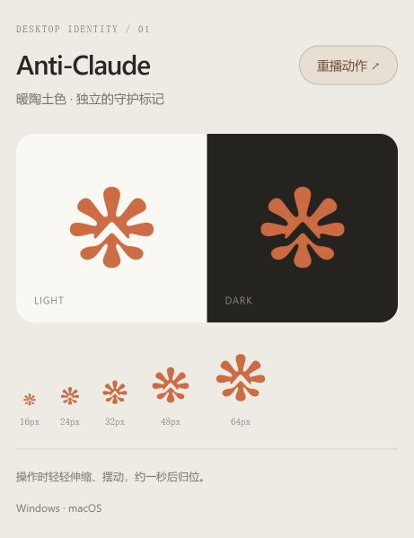
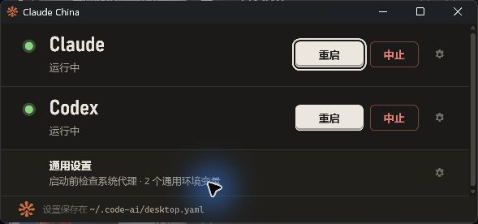

# Claude China desktop identity

暖陶土色的放射形轮廓，中心留出向上的箭头。圆润线条表达助手的亲和感，向上的开口表达独立、保护与持续前进。

## Assets

- `src/claude_china/desktop/ui/icon.png`: 1024 × 1024 RGBA master.
- `src/claude_china/desktop/ui/icon.ico`: Windows, 16 / 20 / 24 / 32 / 40 / 48 / 64 / 128 / 256 px.
- `src/claude_china/desktop/ui/icon.icns`: macOS, including 512 px and 1024 px Retina representations.
- [Motion preview](anti-claude-motion.png): transparent APNG, plays once and rests.
- [Interactive preview](preview.html): light/dark surfaces, actual small sizes, and a replay button.

The application, tray, preview and shortcuts are named **Claude China**. The terracotta mark was originally designed under the Anti-Claude working name; its artwork and motion are preserved.



## Motion

The tray (Windows) / menu bar (macOS) and footer mark make a gentle 960 ms turn and contraction. The native gesture starts when the launcher is ready, when its tray menu or a second launch restores the window, and when launching/stopping an app, choosing a path or saving settings. Rapid actions share one gesture. The animation worker exits at rest; there is no idle animation timer. Shutdown stops the worker and discards queued Cocoa frames.

The footer uses the same motion curve on actions and focus, and respects `prefers-reduced-motion`. Window-title, taskbar, Dock and shortcut icons are static. Native macOS frame updates use `AppHelper.callAfter` with the shared NSApplication.

## Windows taskbar

The process sets `ClaudeChina.DesktopLauncher` as its explicit AppUserModelID before creating native windows. Native installer shortcuts store the same ID and use the icon embedded in the executable. Window icons use a content-addressed ICO in `~/.claudec/icons/`; changing the artwork changes its cache key without deleting older pinned shortcuts' resources. Legacy icons in `~/.code-ai/icons/` are also retained for older shortcuts.

Install the new Windows release to refresh installer-owned shortcuts, then quit and reopen the launcher. No global icon-cache reset or Explorer restart is required.

## Validation

- Full pytest suite: **225 passed, 1 skipped** (Python 3.13.13, Windows).
- Native pywebview / pystray smoke test (Python 3.12.10, Windows): startup and action animations return to the static mark; rapid requests share one worker; closing hides the window; a second launch restores it and animates; quitting during animation removes the tray and releases the instance lock.
- Windows Shell readback confirms the process identity and both installed shortcuts use the same AppUserModelID; the shortcut ICO bytes match the packaged artwork. Native shortcut tests also check command preservation and COM cleanup on failure. Taskbar pixels were not captured by the available window-only screenshot tool.
- Browser preview checked on light/dark surfaces and at 16 / 24 / 32 / 48 / 64 px.
- Wheel build verified to contain the current animation module and all three platform icon assets.
- Rename validation: the built `claude-china` wheel exposes only `claudec`, installs the `claude_china` namespace, and works in a separate environment. Both Windows shortcuts use the new name and command; reopening reuses the running launcher. Existing profile and desktop configuration hashes are unchanged. macOS tests verify the renamed bundle metadata and cleanup of legacy shortcuts.
- Python 3.9 syntax checked. macOS dispatch and asset packaging are covered by tests; macOS native execution has not been performed on this Windows host.



## Re-export

Install the desktop extra, then run:

```powershell
python tools/export_desktop_icons.py
```

To replace the master with another generated PNG, pass `--source <image.png>`.
The exporter preserves transparency, resizes and encodes the platform assets, and uses the actual tray motion code for the APNG preview.

## Image generation provenance

Created with the built-in **image_gen** tool on 2026-10-20. The selected output is the refinement of the first generated mark. PNG resizing and platform format exports use Pillow; runtime animation transforms are implemented in the application.

### Initial prompt

```text
Use case: logo-brand.
Asset type: production desktop app and system tray icon for Anti-Claude, an independent assistant with a resilient, protective personality.
Create ONE original, exceptionally simple and beautiful flat logo glyph on a truly transparent square background. Take inspiration from the warm terracotta palette and soft, organic radial rhythm associated with Claude, while giving this mark its own clear identity. The mark is a compact, bold, gently irregular radial spark with about eight thick rounded tapered rays. At its center, one clean negative-space upward chevron / open A creates a subtle guardian and forward-motion cue. The lower silhouette subtly suggests a protective embrace. Friendly, quietly defiant and technological, not aggressive. Make the overall silhouette balanced and immediately recognizable at 16 pixels. Generous breathing room, centered, glyph occupies roughly 78 percent of the square.
Color palette: a single rich muted terracotta orange, approximately #C96C4A. Entire glyph has solid flat color with crisp antialiased edges; all negative space and background are transparent. No text, no letters printed beside it, no wordmark, no background tile, no extra small symbols, no gradients, no shadows, no 3D, no texture, no glow, no mockup, no border. One polished standalone icon only.
```

### Selected refinement prompt

```text
Use case: precise-object-edit / logo-brand.
Refine this Anti-Claude app icon into a clean production-quality flat logo. Preserve the exact basic design: warm terracotta eight-ray soft radial spark, with the upward chevron negative-space cut through its center. Preserve its proportions and independent friendly identity. Change only rendering cleanliness: make the glyph an absolutely uniform solid terracotta #C96C4A with NO lighting variation, gradient, shading, noise, texture or speckles. Remove ALL scattered pixels, halos and debris outside the deliberate connected silhouettes. Edges should be clean smooth antialiased vector-quality curves. The spaces between rays and the chevron MUST be completely transparent. Center the glyph precisely, with generous equal transparent padding on all four edges. This must work as a crisp tiny 16px desktop tray icon. One flat symbol on genuinely transparent background, no text or mockup.
```
